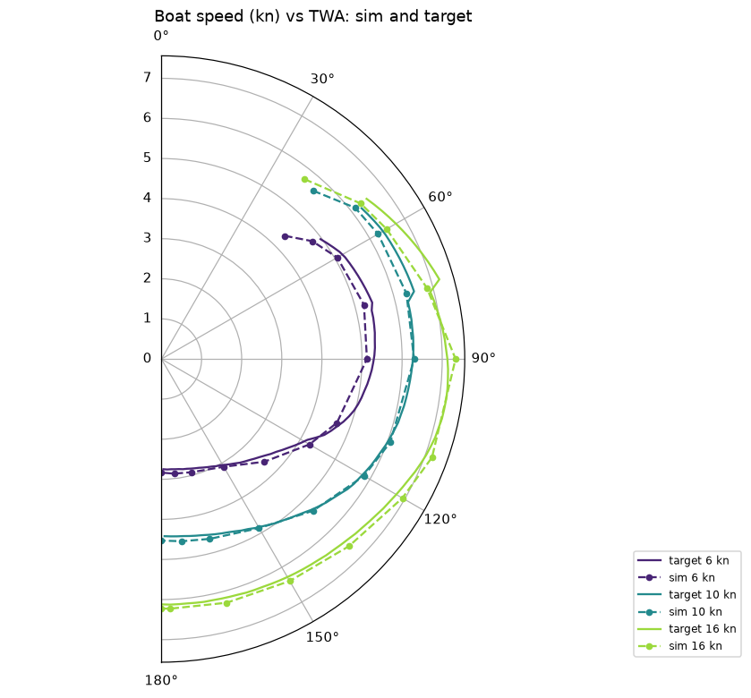

# J/80 polar calibration

Overall: **PASS**

## Targets

- Every TWA is the course's, between the true wind and the track through the water (heading plus leeway), as both references tabulate it; the sim's heading TWA is listed for reference. VMG is the sim's `vmg_kn`, its velocity along the true wind.
- Beat and fixed TWA up to 75 deg: ORC certificate (`orc_polar.csv`, 2019 J/80 certificate).
- Fixed TWA above 75 deg and the run optimum: Python-VPP main + jib (`pyvpp_polar_nospi.csv`). The certificate has no non-spinnaker velocity table and its 90 deg speed appears to carry a spinnaker.
- Targets are interpolated linearly in TWA, then in TWS.

## Criteria

- BSP within 5% of target at every point, including the beat and run optima.
- Beat VMG within 5% of the certificate beat VMG.
- Beat angle: not gated (reported only).
- Run angle and run VMG errors are reported only.
- An unsettled sim point, a NaN BSP, a point with no target, or a missing beat or run row is a fail.
- A BSP or beat-angle miss inside an accepted residual is reported as accepted and does not fail.

## Accepted residuals

| TWS kn | Point | Metric | Bound | Used | Reason |
|---|---|---|---|---|---|
| 16 | 75 deg | bsp | -6 to +0% | yes | owner accepted: -5.4% against the ORC certificate; the certificate polar assumes ORC's default 411 kg crew while the sim sails the 350 kg class maximum (a 411 kg probe recovers about 2 points); bound 0.6 points beyond the residual so a drift fails, signed so a fast point is not accepted |

## Known differences

- The beat angle is reported, not gated. The sim's beat angles are 1 to 3 deg wider than the certificate's: both report TWA to the course over water (heading plus leeway), the Python-VPP and ORC convention.
- Upwind VMG is about 4.5% below the certificate at 6 to 10 kn, from pointing rather than boat speed.
- The certificate assumes ORC's default 411 kg crew; the sim sails the 350 kg class maximum, which costs about 2 to 3% at 16 to 20 kn upwind and reaching.
- The 90 deg and downwind target is Python-VPP main + jib rather than the certificate, whose 90 deg speed appears to carry a spinnaker.

## Summary

| TWS kn | beat TWA err deg | beat BSP err % | beat VMG err % | run TWA err deg | run BSP err % | run VMG err % | result |
|---|---|---|---|---|---|---|---|
| 6 | +2.5 | -0.5 | -4.7 | -2.3 | +4.2 | +3.9 | pass |
| 10 | +3.2 | +0.0 | -4.6 | -2.3 | +3.2 | +2.9 | pass |
| 16 | +1.3 | -2.5 | -4.3 | -1.0 | +1.8 | +1.8 | pass (accepted) |

## TWS 6 kn

| Point | TWA deg | Target | Target kn | Sim kn | Error % | Pass | Heading TWA deg | Heel deg | Leeway deg | Rudder deg | Main / trav / backstay / jib sheet / jib car |
|---|---|---|---|---|---|---|---|---|---|---|---|
| beat | 45.0 | ORC certificate | 4.37 | 4.35 | -0.5 | pass | 41.6 | -6.8 | 3.4 | 2.2 | 0.97 / -0.88 / 0.00 / 0.98 / 0.99 |
| fixed | 52.0 | ORC certificate | 4.93 | 4.77 | -3.2 | pass | 48.8 | -7.3 | 3.2 | 2.2 | 0.97 / -0.84 / 0.00 / 0.99 / 0.99 |
| fixed | 60.0 | ORC certificate | 5.22 | 5.06 | -3.0 | pass | 57.2 | -7.4 | 2.9 | 2.0 | 0.94 / -0.82 / 0.00 / 0.99 / 0.68 |
| fixed | 75.0 | ORC certificate | 5.44 | 5.23 | -3.9 | pass | 72.7 | -6.5 | 2.3 | 1.5 | 0.94 / -0.11 / 0.00 / 0.94 / 0.42 |
| fixed | 90.0 | Python-VPP | 5.29 | 5.12 | -3.2 | pass | 88.2 | -5.3 | 1.8 | 1.3 | 0.85 / -0.09 / 0.00 / 0.76 / 0.42 |
| fixed | 110.0 | Python-VPP | 4.75 | 4.66 | -2.0 | pass | 108.9 | -3.8 | 1.1 | 0.8 | 0.62 / -0.24 / 0.00 / 0.60 / 0.54 |
| fixed | 120.0 | Python-VPP | 4.10 | 4.26 | +3.9 | pass | 119.2 | -2.6 | 0.8 | 0.6 | 0.50 / 0.12 / 0.00 / 0.54 / 0.76 |
| fixed | 135.0 | Python-VPP | 3.46 | 3.62 | +4.8 | pass | 134.4 | -1.2 | 0.6 | 0.5 | 0.17 / 0.04 / 0.00 / 0.72 / 0.06 |
| fixed | 150.0 | Python-VPP | 3.06 | 3.10 | +1.4 | pass | 149.5 | -0.6 | 0.5 | 0.4 | 0.10 / 0.98 / 0.00 / 0.24 / 0.06 |
| fixed | 165.0 | Python-VPP | 2.83 | 2.92 | +3.3 | pass | 164.7 | -0.3 | 0.3 | 0.2 | 0.05 / 0.00 / 0.00 / 0.05 / 0.50 |
| fixed | 180.0 | Python-VPP | 2.75 | 2.83 | +3.0 | pass | 180.0 | 0.0 | -0.0 | 0.0 | 0.00 / 0.00 / 0.00 / 0.00 / 0.50 |
| run | 173.7 | Python-VPP | 2.76 | 2.88 | +4.2 | pass | 173.5 | -0.2 | 0.1 | 0.1 | 0.01 / 0.98 / 0.00 / 0.25 / 0.06 |

Beat angle: sim 45.0, target 42.5 deg (error +2.5 deg). Beat VMG: sim 3.07, target 3.22 kn (error -4.7 %).
Run angle: sim 173.7, target 176.0 deg. Run VMG: sim 2.86, target 2.75 kn (error +3.9 %).

## TWS 10 kn

| Point | TWA deg | Target | Target kn | Sim kn | Error % | Pass | Heading TWA deg | Heel deg | Leeway deg | Rudder deg | Main / trav / backstay / jib sheet / jib car |
|---|---|---|---|---|---|---|---|---|---|---|---|
| beat | 42.1 | ORC certificate | 5.65 | 5.65 | +0.0 | pass | 37.6 | -14.0 | 4.4 | 1.8 | 0.97 / -0.88 / 0.00 / 0.98 / 0.99 |
| fixed | 52.0 | ORC certificate | 6.23 | 6.13 | -1.6 | pass | 47.8 | -15.7 | 4.2 | 1.5 | 0.95 / -0.96 / 0.00 / 0.99 / 0.80 |
| fixed | 60.0 | ORC certificate | 6.38 | 6.24 | -2.3 | pass | 56.2 | -14.2 | 3.8 | 1.2 | 0.93 / -0.60 / 0.00 / 0.94 / 0.59 |
| fixed | 75.0 | ORC certificate | 6.52 | 6.32 | -3.0 | pass | 71.9 | -11.9 | 3.1 | 1.1 | 0.91 / 0.12 / 0.00 / 0.82 / 0.44 |
| fixed | 90.0 | Python-VPP | 6.27 | 6.30 | +0.5 | pass | 87.7 | -9.2 | 2.3 | 1.0 | 0.77 / 0.06 / 0.00 / 0.62 / 0.46 |
| fixed | 110.0 | Python-VPP | 6.01 | 6.07 | +1.0 | pass | 108.7 | -5.6 | 1.4 | 0.7 | 0.50 / -0.04 / 0.00 / 0.62 / 0.46 |
| fixed | 120.0 | Python-VPP | 5.79 | 5.83 | +0.7 | pass | 119.0 | -4.2 | 1.0 | 0.6 | 0.37 / 0.14 / 0.00 / 0.62 / 0.46 |
| fixed | 135.0 | Python-VPP | 5.31 | 5.35 | +0.8 | pass | 134.3 | -3.1 | 0.7 | 0.5 | 0.09 / 0.09 / 0.00 / 0.72 / 0.01 |
| fixed | 150.0 | Python-VPP | 4.84 | 4.87 | +0.6 | pass | 149.5 | -1.9 | 0.5 | 0.4 | 0.01 / 0.98 / 0.00 / 0.70 / 0.01 |
| fixed | 165.0 | Python-VPP | 4.54 | 4.65 | +2.3 | pass | 164.7 | -1.0 | 0.3 | 0.3 | 0.05 / 0.28 / 0.00 / 0.19 / 0.01 |
| fixed | 180.0 | Python-VPP | 4.42 | 4.53 | +2.5 | pass | 180.0 | 0.0 | -0.0 | 0.0 | 0.00 / 0.28 / 0.00 / 0.14 / 0.01 |
| run | 173.7 | Python-VPP | 4.43 | 4.57 | +3.2 | pass | 173.5 | -0.6 | 0.2 | 0.1 | 0.06 / 0.98 / 0.00 / 0.72 / 0.01 |

Beat angle: sim 42.1, target 38.9 deg (error +3.2 deg). Beat VMG: sim 4.19, target 4.40 kn (error -4.6 %).
Run angle: sim 173.7, target 176.0 deg. Run VMG: sim 4.55, target 4.42 kn (error +2.9 %).

## TWS 16 kn

| Point | TWA deg | Target | Target kn | Sim kn | Error % | Pass | Heading TWA deg | Heel deg | Leeway deg | Rudder deg | Main / trav / backstay / jib sheet / jib car |
|---|---|---|---|---|---|---|---|---|---|---|---|
| beat | 38.5 | ORC certificate | 5.88 | 5.73 | -2.5 | pass | 32.8 | -19.8 | 5.8 | 2.0 | 0.97 / -0.11 / 0.59 / 0.98 / 0.84 |
| fixed | 52.0 | ORC certificate | 6.49 | 6.30 | -2.9 | pass | 47.1 | -21.6 | 5.1 | 0.9 | 0.88 / -0.07 / 0.45 / 0.94 / 0.62 |
| fixed | 60.0 | ORC certificate | 6.75 | 6.48 | -4.0 | pass | 55.5 | -21.4 | 4.6 | 0.1 | 0.84 / 0.20 / 0.22 / 0.91 / 0.50 |
| fixed | 75.0 | ORC certificate | 7.24 | 6.85 | -5.4 | accepted | 71.4 | -20.3 | 3.7 | -1.4 | 0.71 / -0.06 / 0.11 / 0.77 / 0.62 |
| fixed | 90.0 | Python-VPP | 7.13 | 7.33 | +2.8 | pass | 87.2 | -18.8 | 2.9 | -2.3 | 0.67 / 0.00 / 0.13 / 0.59 / 0.58 |
| fixed | 110.0 | Python-VPP | 7.02 | 7.18 | +2.3 | pass | 108.2 | -9.7 | 1.8 | -0.2 | 0.38 / 0.09 / 0.00 / 0.62 / 0.46 |
| fixed | 120.0 | Python-VPP | 6.76 | 6.94 | +2.6 | pass | 118.6 | -7.3 | 1.4 | 0.1 | 0.20 / 0.00 / 0.00 / 0.62 / 0.46 |
| fixed | 135.0 | Python-VPP | 6.46 | 6.61 | +2.3 | pass | 133.9 | -5.5 | 1.1 | 0.4 | 0.05 / 0.53 / 0.00 / 0.70 / 0.01 |
| fixed | 150.0 | Python-VPP | 6.28 | 6.40 | +1.8 | pass | 149.3 | -5.7 | 0.7 | 0.2 | 0.08 / 0.71 / 0.00 / 0.70 / 0.01 |
| fixed | 165.0 | Python-VPP | 6.17 | 6.29 | +2.0 | pass | 164.6 | -3.3 | 0.4 | 0.2 | 0.08 / 0.71 / 0.00 / 0.06 / 0.01 |
| fixed | 180.0 | Python-VPP | 6.12 | 6.22 | +1.7 | pass | 180.0 | 0.0 | -0.0 | 0.0 | 0.10 / 0.97 / 0.00 / 0.70 / 0.01 |
| run | 178.0 | Python-VPP | 6.12 | 6.23 | +1.8 | pass | 177.8 | -1.3 | 0.2 | 0.0 | 0.06 / 0.73 / 0.00 / 0.62 / 0.01 |

Beat angle: sim 38.5, target 37.2 deg (error +1.3 deg). Beat VMG: sim 4.48, target 4.68 kn (error -4.3 %).
Run angle: sim 178.0, target 179.0 deg. Run VMG: sim 6.23, target 6.12 kn (error +1.8 %).

Accepted (fixed 75.0 deg, bsp): owner accepted: -5.4% against the ORC certificate; the certificate polar assumes ORC's default 411 kg crew while the sim sails the 350 kg class maximum (a 411 kg probe recovers about 2 points); bound 0.6 points beyond the residual so a drift fails, signed so a fast point is not accepted.

